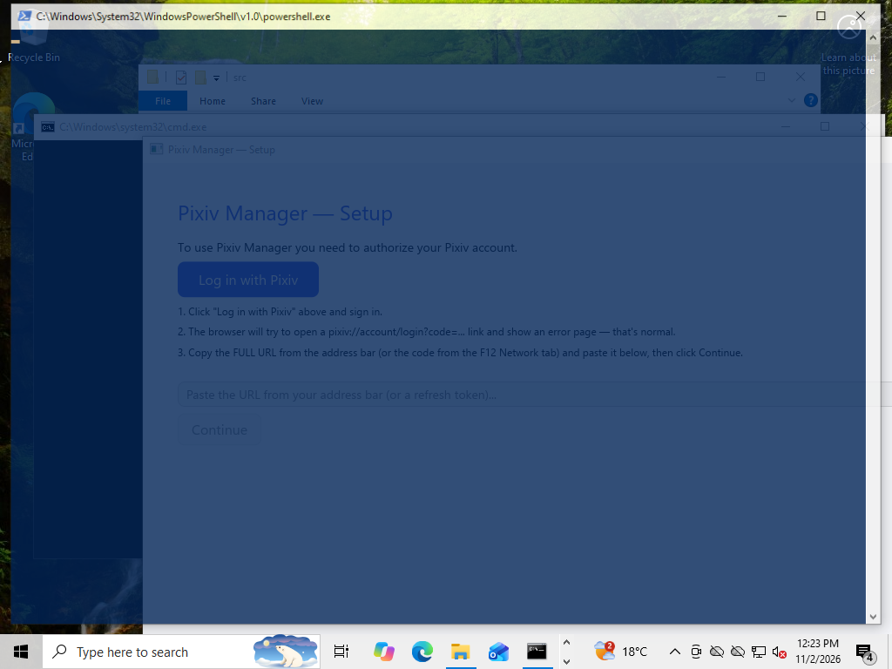

# Cross-platform support report

Status of the Windows/macOS port of `pixiv-manager`, as required by the
cross-platform specification. It separates what was **tested**, what is
**supported**, what is **experimental**, and what was **not implemented**.

- Baseline commit before the work: `747fc0ffb975f401c7073e7c4d33dab77889f0fa`
- Toolchain: stable Rust, pinned by `rust-toolchain` (was `nightly` locally,
  stable in CI — now one toolchain everywhere).
- Dependency graph: one committed `Cargo.lock`, consumed with `--locked` by
  every platform job and every release artifact.

---

## 1. Status matrix

| Platform | Target | Status | Evidence |
|---|---|---|---|
| Linux x86-64 | `x86_64-unknown-linux-gnu` | **Supported, tested** | Full suite green (435 tests), release build green, GUI/CLI used for development |
| Windows 10/11 x86-64 | `x86_64-pc-windows-msvc` (release) | **Supported, tested natively** | Full suite green (432 tests) on a native Windows VM; GUI launched and screenshotted; release PE verified (GUI subsystem, icon, VERSIONINFO, manifest) |
| macOS 11+ arm64 | `aarch64-apple-darwin` | **Experimental** | The macOS-specific code (`platform/*`, `io/paths.rs`) type-checks for the Apple target; the full workspace cannot be built on Linux (see §7.2). No Mac available to run it |
| macOS 11+ x86-64 | `x86_64-apple-darwin` | **Experimental** | Same as above; Universal 2 bundling is scripted but untested |

Nothing in this report claims macOS support beyond "compiles and the
platform-specific code paths are implemented"; the specification explicitly
forbids equating compilation with support.

### What "tested" means here

- **Linux**: `cargo fmt --check`, `cargo clippy --workspace --locked -- -D
  warnings`, `cargo test --workspace --locked`, `cargo build --release
  --workspace --locked` — all green on stable 1.99.1.
- **Windows**: the whole test suite was executed on a native Windows 10 VM
  (`x86_64-pc-windows-gnu` toolchain, since the VM has no MSVC build tools),
  plus runtime smoke tests of the GUI and CLI, plus PE resource inspection.
  The *release target* is MSVC; see §7 for how the MSVC path was validated.

---

## 2. Architecture changes

The specification's dependency direction is preserved:

```text
application logic (app/, widgets/, twitter/, bilibili/, core.rs)
        │
        ▼
portable interfaces (io::paths, io::{write_atomic, …}, platform)
        │
        ▼
OS details (dirs crate, std::fs, ReplaceFileW/MoveFileExW, sysinfo, iced modifiers)
```

### 2.1 `pixiv-manager/src/platform/` — the narrow OS layer

| Module | Responsibility |
|---|---|
| `platform/mod.rs` | `os_name()`, `arch()` for the debug overlay; re-exports |
| `platform/memory.rs` | `memory_stats() -> MemoryStats { process_used_mb: Option<f64>, system_total_mb: Option<f64> }` via `sysinfo`; cached probe; `None` renders as `N/A` |
| `platform/shortcuts.rs` | `primary_modifier(Modifiers)` (Ctrl everywhere, ⌘ on macOS), `primary_label()`, `primary_shortcut(key)`, `minus_label()` |
| `platform/fs.rs` | `replace_file(src, dest)` — the *only* atomic-replacement primitive: `rename(2)` + directory fsync on Unix, `ReplaceFileW` / `MoveFileExW(REPLACE_EXISTING\|WRITE_THROUGH)` with transient-sharing-violation retries on Windows |

The overlay's `/proc/self/statm` and `/proc/meminfo` readers were deleted along
with the `#[cfg(target_os = "linux")]` blocks in `app/view.rs`. There is no
`/proc` access outside the `sysinfo` dependency any more.

### 2.2 `pixiv-manager/src/io/paths.rs` — the path authority

`AppPaths { config_dir, data_dir, cache_dir }` with `discover()` recomputed per
call (so tests and subprocesses that set `PIXIV_MANAGER_CONFIG_DIR` see it
immediately) and `rooted()` for overrides/portable installs.

It owns every location the app uses: `config_file()`, `library_dir()`,
`bookmarks_file()`, `download_queue_file()`, `colors_file()`, `meta_dir()`,
`viewer_transforms_file()`, `image_cache_dir()`, `twitter_cookie_file()`,
`bilibili_cookie_file()`, `twitter_graphql_file()`.

`io::config`, `io::library`, `io::colors`, `io::meta_cache`, `viewer_tools`,
`image::cache`, the Twitter/Bilibili cookie+GraphQL discovery and the settings
UI now all derive their paths from it. `dirs::*` is called in exactly one place.

### 2.3 One atomic writer

`io::write_atomic` / `io::save_json_atomic` / `io::save_json_compact_atomic` /
`io::write_atomic_private` (owner-only `0600` on Unix, used for the config that
holds the refresh token) replace five independent temp-file-plus-rename copies:

| Was | Now |
|---|---|
| `io/mod.rs` (rename + `remove_file` fallback) | canonical implementation |
| `io/colors.rs` (`File::create` + rename, no error handling) | `io::save_json_compact_atomic` |
| `io/meta_cache.rs` (write + rename + `remove_file` fallback) | `io::save_json_compact_atomic` |
| `viewer_tools.rs` (write + rename, failed if the file existed on Windows) | `io::save_json_compact_atomic` |
| `image/cache.rs` (write + rename + `remove_file` fallback) | `io::write_atomic` |
| `io/config.rs` (`OpenOptions::write` in place — not atomic at all) | `io::write_atomic_private` |
| download writes in `app/update/jobs.rs`, `cli/download.rs` | `io::write_atomic` (no truncated images after a crash) |

Crash semantics: bytes are written and `fsync`ed to `<name>.tmp<pid>` in the
*destination directory*, then swapped in with one filesystem operation, so the
final name always holds either the old or the new complete content. A crash can
only leave a stale temp file, which the next write overwrites and readers
ignore.

### 2.4 String/UX neutralization

- Shortcut hints are generated (`platform::shortcuts`) instead of hard-coded
  `Ctrl+F`; the table now lists Find / grid bigger / smaller / reset
  separately, with `⌘F`, `⌘+`, `⌘−`, `⌘0` on macOS.
- `Ctrl` checks for Find and grid-size now go through `primary_modifier()`.
- The settings screen derives its cookie-file and gallery-directory hints from
  `AppPaths` / `core::default_gallery_dir()` — no literal `~/.config` strings.
- Debug overlay shows `N/A` when memory figures are unavailable.

### 2.5 Tests made platform-neutral

- `tests/cli.rs`: `XDG_CONFIG_HOME` + a global mutex replaced by a per-test
  temp dir passed to the subprocess as `PIXIV_MANAGER_CONFIG_DIR` via
  `Command::env`. `CONFIG_ENV_LOCK` is gone.
- `XDG_*` support was removed from `io::config` / `io::library`; the
  `test-util` fallback is now a per-process temp root.
- `/tmp/...` literals in `e2e_tests.rs`, `ui_tests.rs` and a profiling test were
  replaced with `std::env::temp_dir()`-derived paths.
- `layer_probe` / `min_layer_probe` write their snapshots to the OS temp
  directory instead of a tracked `pixiv-manager/target/` directory, and the
  accidentally committed probe PNGs were removed from git.
- `test_util::headless_iced()` serialises headless renderer construction; see
  §6 (pre-existing crash).

### 2.6 Build/packaging additions

- `pixiv-manager/build.rs`: Windows resources (icon + VERSIONINFO + manifest)
  for both executables via `winresource`, skipped for non-Windows targets and
  opt-outable with `PIXIV_MANAGER_SKIP_WINRESOURCES=1` for cross `cargo check`.
- `assets/icons/pixiv-manager.{png,ico,icns}`: version-controlled icons with
  16/24/32/48/64/128/256 px and ICNS chunks for 16…1024 px, generated
  reproducibly by `scripts/make-icons.py`. The Linux installer installs the
  committed PNG instead of synthesising one.
- `assets/windows/app.manifest`: `asInvoker` (no elevation), PerMonitorV2 DPI,
  `longPathAware`, supportedOS Win8→Win11.
- `pixiv-manager/src/profiling/cpu_stub.rs` + a `#[path]` switch in
  `profiling/mod.rs`: `pprof` is a `cfg(unix)` dependency and CPU sampling
  degrades to an explicit "unsupported" stub on Windows.
- `scripts/stamp-version.sh`, `scripts/package-linux.sh`,
  `scripts/package-windows.ps1`, `scripts/package-macos.sh`,
  `packaging/linux/*.desktop`, `packaging/windows/PixivManager.wxs`,
  `packaging/macos/{Info.plist.in,entitlements.plist}`.

---

## 3. Filesystem locations

| Kind | Linux | Windows | macOS |
|---|---|---|---|
| Config (refresh token, cookies, GraphQL override) | `$XDG_CONFIG_HOME/pixiv-manager` (`~/.config/…`) | `%APPDATA%\pixiv-manager` | `~/Library/Application Support/pixiv-manager` |
| Data (bookmarks, queue, colours, metadata, transforms) | `$XDG_DATA_HOME/pixiv-manager/library` (`~/.local/share/…`) | `%LOCALAPPDATA%\pixiv-manager\library` | `~/Library/Application Support/pixiv-manager/library` |
| Cache (image bytes) | `$XDG_CACHE_HOME/pixiv-manager/images` (`~/.cache/…`) | `%LOCALAPPDATA%\pixiv-manager\cache\images` | `~/Library/Caches/pixiv-manager/images` |

`PIXIV_MANAGER_CONFIG_DIR` collapses config/data onto one root and puts the
cache in `<root>/cache`; it is the only override and is what the test suite
uses.

**Compatibility:** the config file, library directory, colours, metadata and
viewer transforms keep their previous Linux paths (the data root is
`dirs::data_local_dir()`, which equals `dirs::data_dir()` on Linux) — no format
or location migration for existing users.

**Cache move (the one intentional relocation):** image bytes moved from
`<data>/pixiv-manager/cache` to the OS cache directory. On first start
`image::cache::migrate_legacy_cache()` moves existing files across
best-effort, logs the count, and never deletes bytes it could not move; a cache
loss only costs re-downloads. It is skipped entirely when
`PIXIV_MANAGER_CONFIG_DIR` is set (that would point at real user data).

---

## 4. Test results

### 4.1 Linux (native, stable 1.99.1)

| Command | Result |
|---|---|
| `cargo fmt --check` | pass |
| `cargo clippy --workspace --locked -- -D warnings` | pass, no warnings |
| `cargo test --workspace --locked` | **435 passed, 0 failed, 2 ignored (live tests)** |
| `cargo build --release --workspace --locked` | pass |
| `cargo check --workspace --all-targets --features pixiv-manager/profiling` | pass (only pre-existing test-target warnings) |

Per target: 233 lib, 24 pixivj-rs, 15 CLI, 53 e2e, 82 UI, 10 Twitter, 8
Bilibili, 8 proptest, 1+1 layer probes.

The Windows suite was run one test target per `cargo` invocation with `-j 2`:
the VM has 4 GB RAM and very little free disk, and `cargo test --workspace`
exhausted it while linking ten test binaries in parallel. Every target was
executed; the aggregate result is identical to a single workspace run.

### 4.2 Windows (native VM, `x86_64-pc-windows-gnu`, stable 1.99.1)

| Target | Result |
|---|---|
| `pixiv-manager --lib` | **231 passed, 0 failed** (233 on Linux; two tests are Unix-only `0600` permission checks) |
| `pixivj-rs --lib` | 24 passed |
| `--test cli` | 14 passed (the 15th is Unix-only: `0600` mode) |
| `--test e2e_tests` | 53 passed |
| `--test ui_tests` | 82 passed |
| `--test twitter_tests` | 10 passed, 1 ignored (live) |
| `--test bilibili_tests` | 8 passed, 1 ignored (live) |
| `--test proptest` | 8 passed |
| `--test layer_probe` / `--test min_layer_probe` | 1 + 1 passed |
| **total** | **432 passed, 0 failed, 2 ignored** (Linux runs 435: the two Unix-only permission tests plus one Unix-only CLI test) |
| `cargo build --release --workspace --locked` | pass |

Windows-specific coverage that the new tests add:

- atomic writer: overwrite repeatedly, create missing parents, no temp litter,
  failed replace leaves the destination untouched;
- config written owner-only on Unix / normal ACLs on Windows, and the token
  file is never briefly world-readable on Unix;
- bookmark library, download queue, colour palettes and viewer transforms each
  survive **five consecutive saves** over an existing file (the exact sequence
  that failed on Windows before);
- path layer: derived files, `PIXIV_MANAGER_CONFIG_DIR` override, absolute
  paths, cache separate from data;
- platform layer: `primary_modifier` semantics per OS, memory stats report real
  figures, `replace_file` behaviour.

### 4.3 Windows runtime smoke tests (native VM)

Executed on a Windows 10 VM over SSH; GUI checks were run inside the
interactive desktop session (session 1) through a scheduled task, because an
SSH session has no visible desktop.

| Check | Result |
|---|---|
| `pixiv-manager-cli.exe --version` | OK: `pixiv-manager 0.1.0` |
| `config --set` / `config --show` with an isolated `PIXIV_MANAGER_CONFIG_DIR` | OK; `config.toml` written inside the isolated dir, token masked in `--show` |
| Repeated config writes over an existing file | OK (unit tests + two manual `--set` runs) |
| GUI launches in a real desktop session | **OK** — window appears; see `docs/windows-gui.png` |
| Window title / window handle | `Pixiv Manager - Setup` (onboarding phase), valid HWND in session 1 |
| Graceful shutdown (WM_CLOSE, i.e. the X button) | **OK** — process exited within 15 s, no hang |
| Onboarding server | bound to `127.0.0.1:<ephemeral>` only; log line `Server listening on http://127.0.0.1:50286` |
| Path layer at runtime | log shows `Config dir` / `Data dir` / `Cache dir` from `AppPaths`, honouring the override |
| Cache directories created | `%PIXIV_MANAGER_CONFIG_DIR%\cache\images` and `...\images\thumb` |
| Release GUI has no console | **verified**: PE subsystem **2 (WINDOWS_GUI)** for `pixiv-manager.exe`; **3 (CONSOLE)** for `pixiv-manager-cli.exe` |
| Icon + `VERSIONINFO` in the PE | **verified** via `FileVersionInfo`: ProductName, FileDescription, FileVersion `0.1.0`, CompanyName, OriginalFilename for both binaries |
| Application manifest in the PE | **verified** (`PerMonitorV2`, `asInvoker`, `longPathAware` present in resources) |
| Release binary sizes | GUI 12.6 MB, CLI 2.9 MB |
| Portable ZIP | built by `scripts/package-windows.ps1` (6.9 MB) + `SHA256SUMS.txt` verified |
| MSI build | **built with WiX 5.0.2** (`PixivManager-0.1.0-x86_64.msi`, 5.8 MB), no warnings |
| MSI install (silent, per-user) | **OK** — `%LOCALAPPDATA%\Programs\Pixiv Manager` contains `pixiv-manager.exe`, `pixiv-manager-cli.exe`, `README.md`; no elevation required |
| MSI Start-menu entry | **OK** — `Pixiv Manager.lnk` created |
| MSI Apps & features entry | **OK** — `DisplayName=Pixiv Manager`, `DisplayVersion=0.1.0`, `Publisher=Pixiv Manager contributors` |
| MSI uninstall | **OK** — install dir, Start-menu folder and uninstall entry all removed |
| Dark theme | **OK** — the app follows the system dark mode (screenshot) |
| DPI | VM runs at 100 % scaling, so per-monitor scaling itself could not be exercised; the manifest requests `PerMonitorV2` and winit/iced handle `Rescaled` events |

Not exercised on Windows (no credentials on the VM, by design): live Pixiv
onboarding against the real API, real Twitter/Bilibili cookie sessions, and
real image downloads from Pixiv's CDN. Their offline equivalents (cookie
parsing, feed conversion, filename/path rules, download queue, image cache
writes, atomic persistence) are covered by the passing suite.



---

## 5. Packaging

### Linux

`scripts/package-linux.sh` → `pixiv-manager-VERSION-x86_64-linux.tar.gz`
(GUI + CLI + README + desktop entry + PNG icon). `./install.sh` remains the
Linux/KDE installer (`~/.local/bin`, `~/.local/share/applications`,
hicolor icon from `assets/icons/`, KDE cache refresh); it deliberately does not
try to detect other platforms.

### Windows

- `pixiv-manager-VERSION-x86_64-windows.zip` — portable, no install, no
  registry, no writes outside the user profile.
- `PixivManager-VERSION-x86_64.msi` — WiX v4/v5 source
  (`packaging/windows/PixivManager.wxs`): per-user install to
  `%LOCALAPPDATA%\Programs\Pixiv Manager` (no admin prompt), Start-menu
  shortcut with icon, uninstall entry, no PATH modification, no services, no
  startup entries, no firewall rules.
  The `.wxs` is built and the MSI installed/uninstalled on the Windows VM; the
  release job pins **WiX 5.0.2** because WiX 6+ refuses to run without
  accepting the Open Source Maintenance Fee EULA (`WIX7015`).
- `scripts/package-windows.ps1` builds both, signs when
  `WINDOWS_CERT_PFX_BASE64`/`WINDOWS_CERT_PASSWORD` are present (Authenticode,
  SHA-256, RFC3161 timestamp, `signtool verify /pa` afterwards), rebuilds the
  ZIP from the signed executables, and writes `SHA256SUMS.txt`.
- No UPX/packers, no SFX archives, no runtime extraction, no bootstrap
  downloader.

### macOS

`scripts/package-macos.sh` → `Pixiv-Manager-VERSION-universal.dmg` (Universal 2
`.app` with `Info.plist` + `icon.icns`, hardened runtime, optional Developer ID
signing, `notarytool` submit + `stapler staple`) and
`pixiv-manager-cli-VERSION-macos.tar.gz`. Bundle identifier
`io.github.octo-kumo.pixiv-manager` — the project's own GitHub namespace, not an
invented domain.

### Release pipeline

`.github/workflows/release.yml` is staged:

```text
prepare-version ──┬─> build-linux ──┐
                  ├─> build-windows ┼─> publish
                  └─> build-macos ──┘
```

`prepare-version` computes the version **once** (manual override supported) and
exposes version/tag/SHA; every build job checks out that SHA, stamps that
version (`scripts/stamp-version.sh`, which also refreshes `Cargo.lock` so
`--locked` still passes), runs its platform tests, builds, packages and uploads
artifacts. `publish` downloads all artifacts, **verifies every expected file
exists**, regenerates a combined `SHA256SUMS.txt`, and creates exactly one
GitHub Release with the notes documenting the source commit.

---

## 6. Pre-existing defects found and fixed

| Defect | Impact | Fix |
|---|---|---|
| `e2e_tests` and `ui_tests` died with SIGSEGV in parallel runs (reproducible on the untouched baseline, `--test-threads=1` passed) | Whole test binary aborted; would have made Windows CI look broken | Root cause found with gdb: concurrent `wgpu::Instance::new` → concurrent Vulkan ICD `dlopen` → null deref in `loader_icd_scan`. `test_util::headless_iced()` now serialises renderer construction only (rendering stays parallel) |
| The same code path crashed CI-equivalent runs on Linux, and README/AGENTS documented `--all-targets` clippy while CI used `--workspace` | Confusing docs | CI is the source of truth; README/AGENTS updated |
| Tests wrote probe screenshots into a tracked `pixiv-manager/target/` directory and modified committed PNGs | Repo dirtied by every test run; machine-specific binaries committed | Probes write to the OS temp dir; artifacts removed from git; `target/` ignores any depth |
| `io/config.rs` wrote the TOML in place (no atomic replace, no fsync) | A crash during save could truncate the config that holds the refresh token | `io::write_atomic_private` |

`Cargo.lock` was gitignored for an application with signed multi-platform
releases; it is now committed and used with `--locked`.

---

## 7. Platform-specific limitations and remaining issues

1. **Windows builds were exercised with the GNU toolchain, not MSVC.** The test
   VM has no Visual Studio build tools (nor the disk for them), so the natively
   executed suite ran on `x86_64-pc-windows-gnu`. The *release* target remains
   `x86_64-pc-windows-msvc` (as required); the MSVC-specific inputs are the
   resource path (`rc.exe` vs `windres`, both driven by `winresource`), the
   `windows-sys` bindings for `ReplaceFileW`/`MoveFileExW`, and `aws-lc-sys`,
   which needs CMake + NASM — all of which the new `windows-latest` CI job
   installs/verifies. Treat the first green MSVC CI run as the final gate.

2. **macOS is experimental.** The macOS-specific modules (`src/platform/*`,
   `src/io/paths.rs`) were type-checked for `aarch64-apple-darwin` with a small
   harness crate; a full `cargo check --target aarch64-apple-darwin` of the
   workspace is impossible on Linux because `aws-lc-sys` needs a macOS C
   toolchain, so the macOS job in CI is the first real compile. ⌘-based
   shortcuts, Application Support/Caches paths, `.app` bundling, Universal 2,
   signing and notarization are implemented, but nothing has been run on a Mac.
3. **No Windows code signing certificate is available here.** The pipeline is
   signing-ready (PFX via secrets, timestamping, verification, re-signed ZIP)
   but all artifacts produced locally are unsigned; unsigned binaries trigger
   SmartScreen and may attract AV false positives until the certificate
   identity is established.
4. **GNU-only linker warning.** With `x86_64-pc-windows-gnu`, GNU `ld` merges
   its own default manifest with the one embedded here and warns
   `.rsrc merge failure: multiple non-default manifests`. MSVC's linker does
   not inject a manifest of its own, so this is expected to be specific to the
   GNU test toolchain; the embedded resources themselves are correct (icon,
   VERSIONINFO and our manifest are all present in the PE).
5. **MSI install/uninstall was tested, but not on a pristine machine.** It was
   installed, inspected and uninstalled on the test VM (per-user scope, Start
   menu, ARP entry, clean removal). A test on a fresh Windows image — ideally
   with Defender enabled — is still recommended before the first public release.
6. **Credential storage** (Credential Manager / Keychain / Secret Service) is
   not implemented; the refresh token stays in the protected config file. This
   was explicitly out of scope for the first Windows release.
7. **Live provider paths untested on Windows** (onboarding against Pixiv, real
   Twitter/Bilibili cookies, real downloads) — the VM intentionally has no
   credentials.
8. **No SBOM/provenance attestation yet.** `SHA256SUMS.txt` + commit/`Cargo.lock`
   tracing is in place; SBOM was listed as desirable, not blocking.

---

## 8. Security decisions

- **Explicit cookie files only.** The app never reads Chrome/Firefox/Edge
  cookie databases, DPAPI-protected sessions or OS credential stores; it reads
  the Netscape-format file the user exports and points it at. This is enforced
  by review and documented in the README.
- **No privilege escalation.** The MSI is per-user (`asInvoker`), the manifest
  requests `asInvoker`, and no step requires administrator rights.
- **No hidden persistence.** No services, startup entries, scheduled tasks,
  firewall rules, drivers or browser extensions are installed. The onboarding
  server binds `127.0.0.1` only (unchanged), keeps its per-session nonce, and
  logs the token *length*, never its content.
- **Config permissions.** `config.toml` (refresh token) is created `0600` on
  Unix — including the temp file, so the token is never briefly world-readable;
  on Windows it inherits the user profile ACLs. No secret is written to logs.
- **Signing.** Secrets are consumed only in the `workflow_run`/manual release
  path (never `pull_request`), and are absent in forks; the scripts warn and
  continue unsigned rather than failing, so contributors can still build.
- **No packers.** Deliberately no UPX/SFX/obfuscation/bootstrap downloaders, to
  keep antivirus heuristics boring and reproducible builds possible.

---

## 9. Not implemented (explicitly out of scope)

UWP/WinUI/Cocoa rewrites, Electron/Tauri, browser cookie extraction, automatic
updater, Windows service, shell extensions, file associations, startup
registration, Windows ARM64, Microsoft Store / Mac App Store submission, Linux
packaging redesign (AppImage/Flatpak), universal OS credential manager, and
platform-specific GPU backend selection UI.

---

## 10. How to verify this yourself

```bash
# Linux (or any Unix): full CI equivalent
cargo fmt --check
cargo clippy --workspace --locked -- -D warnings
cargo test --workspace --locked
cargo build --release --workspace --locked

# Windows
cargo test --workspace --locked
cargo build --release --workspace --locked
# then check the GUI binary is a windowed app:
powershell -c "$b=[IO.File]::ReadAllBytes('target\release\pixiv-manager.exe'); $p=[BitConverter]::ToInt32($b,0x3c); [BitConverter]::ToUInt16($b,$p+0x5c)"  # 2 = GUI

# Packaging
./scripts/package-linux.sh 1.2.3
pwsh ./scripts/package-windows.ps1 -Version 1.2.3     # needs WiX for the MSI
./scripts/package-macos.sh 1.2.3                      # on macOS
```
