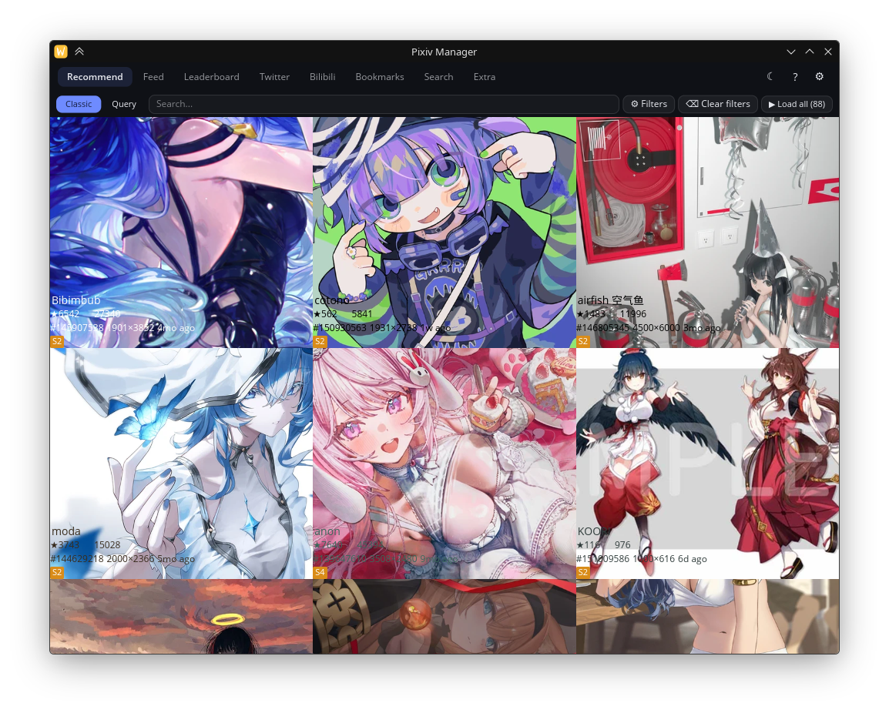
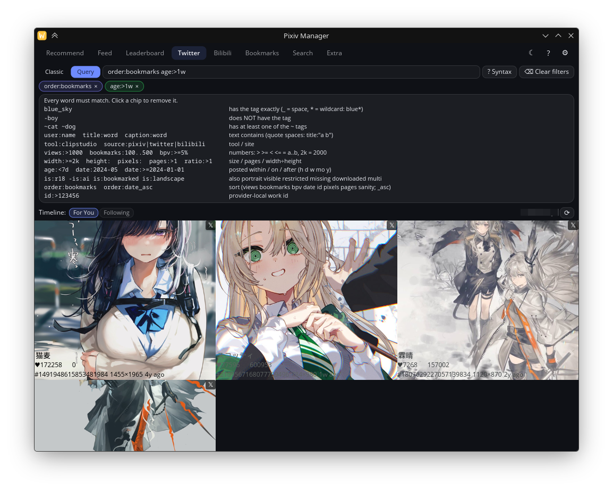
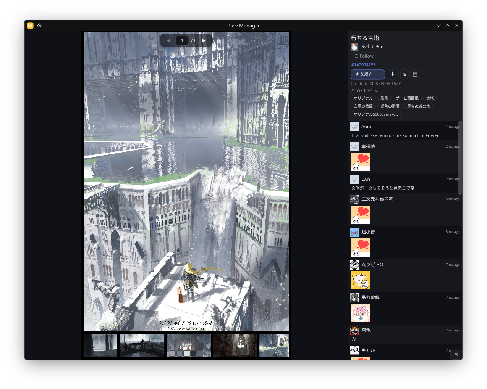

# pixiv-manager

> Yun@2026OCT24: hello, this is a AI rewrite of the original pixiv manager i made quite a long time ago
> https://github.com/octo-kumo/pixiv-manager
> this ver is on all measures, an improvement over the original







A desktop client for browsing, filtering and downloading Pixiv artwork — and,
since recently, your Twitter/X **photo feed and likes** and your Bilibili
**dynamic feed** side by side with Pixiv bookmarks.

Built in Rust with [iced](https://iced.rs): a Pixiv API library (`pixivj-rs`),
the GUI/CLI app (`pixiv-manager`), and cookie-authenticated clients for
Twitter (`pixiv-manager/src/twitter`) and Bilibili
(`pixiv-manager/src/bilibili`) that fold their posts into the same unified
media model.

## Build & run

```bash
cargo build --release
./target/release/pixiv-manager        # GUI
./target/release/pixiv-manager-cli    # CLI (Pixiv)
```

Tests / lints (what CI runs):

```bash
cargo fmt --check
cargo clippy --workspace --all-targets -- -D warnings
cargo test --workspace
```

## Twitter / X setup

X has no supported API for third-party clients, so the app uses the same
internal GraphQL endpoints as x.com, authenticated with your browser cookies.

1. Export your x.com cookies in Netscape `cookies.txt` format (any "export
   cookies" browser extension works; keep `auth_token`, `ct0` and `twid`).
2. Either drop the file at `./twitter_cookies.txt` /
   `~/.config/pixiv-manager/twitter_cookies.txt`, or point the app at it in
   **Settings → Twitter cookies file** and press **Reload**.
3. The Twitter tab now shows your home timeline (For You / Following, photo
   tweets only). The Bookmarks tab mixes Pixiv bookmarks with your liked
   tweets; liking a tweet in the app auto-downloads its photos, and the
   bookmark sync pulls likes into the local library.

The cookies are only ever sent to `x.com` / `abs.twimg.com`; the file is
gitignored and never read by tests.

## Bilibili setup

Bilibili's web APIs are used directly with your browser cookies (`SESSDATA`,
`bili_jct` and `DedeUserID`).

1. Export your bilibili.com cookies in Netscape `cookies.txt` format.
2. Either drop the file at `./bilibili_cookies.txt` /
   `~/.config/pixiv-manager/bilibili_cookies.txt`, or set it in
   **Settings → Bilibili cookies file** and press **Reload**.
3. The Bilibili tab shows image dynamics (`DYNAMIC_TYPE_DRAW` / opus posts
   with pictures; videos and text-only posts are skipped) from either:
   - **Following** — everyone you follow (`t.bilibili.com`), or
   - **Users** — a fixed list of user ids you enter in
     **Settings → Bilibili users** (e.g. `2105955, 12345678`).

   Reposts resolve to the original post and are attributed to its author.
4. Opening a dynamic shows its images (the original "大图" for the viewer and
   downloads), description, author and comments.

Bilibili has no liked-posts feed, so Bilibili **bookmarks are tracked
locally**: bookmarking a post is a like (a best-effort `thumb` request is
sent) and the post is kept in the local bookmark library, which also feeds
the mixed Bookmarks tab and "Download all". Posts you already liked on
Bilibili are imported into the local library the first time you see them in a
feed.

## Usage notes

- **Shift-click** any gallery tile to toggle its bookmark without opening the
  viewer (bookmarking auto-downloads the images, Pixiv/Twitter/Bilibili
  alike). A plain click opens the viewer.
- Feeds paginate lazily and cache in memory: switching tabs or scrolling back
  never refetches, and newly fetched Bilibili pages are merged into
  newest-first order as they arrive instead of being re-sorted in bulk.
- The dynamic "Created" timestamp, relative tile dates and date sorting all
  come from Bilibili's `pub_ts` (string-encoded, as the API sends it).

## Refreshing the Twitter query ids

X rotates the opaque `queryId` values embedded in its web bundle every few
months. When they go stale, Twitter fetches fail with an HTTP 404 and the app
shows an error mentioning that the query id may have rotated.

Open **Settings → Twitter → Update query ids**: the app fetches the current
bundles from x.com itself (using your cookies), extracts the ids, writes them
to `twitter_graphql.json`, and reloads the client — no rebuild, no shell
script. The compiled-in defaults remain in
[`pixiv-manager/src/twitter/graphql.rs`](pixiv-manager/src/twitter/graphql.rs).

The override file is resolved in this order:

1. `$PIXIV_MANAGER_TWITTER_GRAPHQL` (explicit path, for custom installs/tests)
2. `twitter_graphql.json` next to `config.toml`
   (`~/.config/pixiv-manager/twitter_graphql.json`)
3. `twitter_graphql.json` in the working directory

Only the operations listed are overridden; everything else keeps its default,
and blank values are ignored. The format:

```json
{
  "queries": {
    "HomeTimeline": "…",
    "HomeLatestTimeline": "…",
    "Likes": "…",
    "TweetDetail": "…",
    "TweetResultByRestId": "…",
    "FavoriteTweet": "…",
    "UnfavoriteTweet": "…",
    "Viewer": "…"
  }
}
```

The optional `features` (JSON object) and `bearer_token` (string) fields are
overridden the same way when present.

### The manual way

If the button fails because X changes its bundle layout, drop the ids into
`twitter_graphql.json` yourself:

```bash
# 1. Find the entry bundle in the home page HTML.
curl -s -A 'Mozilla/5.0' -b twitter_cookies.txt https://x.com/home -o /tmp/x.html
grep -o 'https://abs.twimg.com/responsive-web/client-web/main\.[a-f0-9]*\.js' /tmp/x.html

# 2. Download that main.<hash>.js and grep the pairs it contains:
curl -s -A 'Mozilla/5.0' '<url from step 1>' -o /tmp/x_main.js
grep -o 'queryId:"[^"]*",operationName:"[^"]*"' /tmp/x_main.js | sort -u
```

`Likes`, `TweetDetail`, `TweetResultByRestId`, `FavoriteTweet`,
`UnfavoriteTweet` and `Viewer` live in `main.js`. **`HomeTimeline` and
`HomeLatestTimeline` do not** — they sit in a lazy chunk, referenced by the
webpack maps embedded in `/tmp/x.html` (`<chunk id>:"<chunk name>"` and
`<chunk id>:"<hash>"`). Find the chunk whose name mentions `HomeTimeline`
(e.g. `shared~bundle.Compose~bundle.HomeTimeline~bundle.LoggedInMain`) and
download it as `https://abs.twimg.com/responsive-web/client-web/<name>.<hash>a.js`
(note the trailing `a`), then grep it the same way. Copy the new values into
`twitter_graphql.json` and reload Twitter in the app (the "Reload" button
re-reads the file; a restart also picks it up).

### Verify the new ids

The client's live smoke test reads `twitter_cookies.txt` from the repo root,
hits the real endpoints and leaves your account state unchanged (the like
round-trip unlikes and immediately re-likes the same tweet):

```bash
cargo test -p pixiv-manager --test twitter_tests -- --ignored live --nocapture
```

It prints the connected handle and page counts, and fails loudly if any
endpoint still rejects the ids.

The same kind of live smoke test exists for Bilibili (it needs
`bilibili_cookies.txt` in the repo root and also leaves your account state
unchanged):

```bash
cargo test -p pixiv-manager --test bilibili_tests -- --ignored live --nocapture
```
